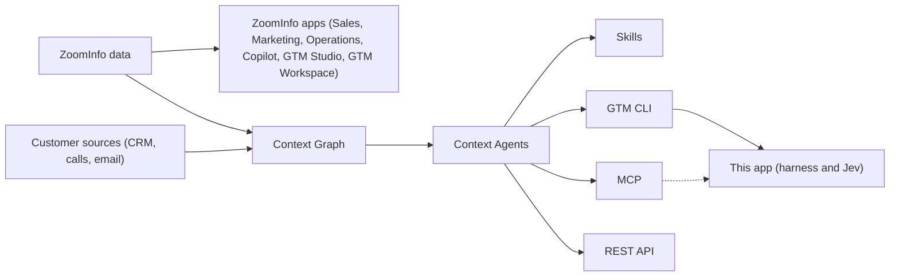

# ZoomInfo and the GTM platform

This spec is the domain model behind the harness and Jev. It records what ZoomInfo and its GTM-branded products are, how GTM AI serves data to outside agents, and the rules this app follows when it relies on them. Every fact about ZoomInfo comes from the [ZoomInfo and GTM AI knowledge base](../external-sources/zoominfo-gtm-ai-knowledge-base.md) (@Sebastian, Oct 20, 2026). Statements about this app point to the spec or source file that implements them.

## 1. Naming: "GTM" and "GTM One"

"GTM" is ZoomInfo's umbrella brand: its Nasdaq ticker since May 13, 2025 (previously ZI), the name of its platform, and the prefix on its newest products ([knowledge base](../external-sources/zoominfo-gtm-ai-knowledge-base.md)). The knowledge base found **no product called "GTM One"**, so these specs use the names ZoomInfo publishes:

| Name | What it is | Who uses it |
| --- | --- | --- |
| GTM Intelligence Platform | ZoomInfo's whole suite: data, AI, signals, orchestration, execution | Everyone; it's the frame |
| GTM Studio | Builds and launches plays and workflows triggered by buying signals (launched May 2025) | RevOps, marketing ops |
| GTM Workspace | AI workspace for day-to-day GTM work | Sellers, marketers |
| GTM AI (gtm.ai) | Developer platform that serves ZoomInfo data and context to AI agents | GTM and AI engineers |
| Copilot | AI sales agent that turns signals into account picks and outreach | Sellers |

This app is a GTM AI client. It sits where the knowledge base places "agents built outside ZoomInfo's apps".

> [!WARNING]
> Until someone confirms what "GTM One" refers to, don't use that name in product copy, prompts or the writer's output. See open question 1.

## 2. How the pieces fit

ZoomInfo's data feeds every product. ZoomInfo's own apps act on it directly; GTM AI merges it with the customer's sources and exposes it to outside agents over three surfaces that share one data foundation ([knowledge base](../external-sources/zoominfo-gtm-ai-knowledge-base.md)).

Signing up on gtm.ai lands in GTM Studio's connector setup, so the developer platform and Studio share one ZoomInfo account ([knowledge base](../external-sources/zoominfo-gtm-ai-knowledge-base.md)). The dashed line is the planned MCP path; today the app calls the bundled CLI ([setup spec](./06-setup-gtm-ai.md)).

## 3. GTM AI building blocks and their counterparts here

### Surfaces

| Surface | Knowledge base | This app |
| --- | --- | --- |
| CLI | Research and enrich from a terminal or script | **Primary.** `@zoominfo/gtm-ai-cli` is bundled and run by the harness; see [setup spec](./06-setup-gtm-ai.md) and [agentic harness](./07-agentic-harness.md) |
| MCP | Call ZoomInfo tools from an agent | Planned. Each command records its MCP tool name (`mcpTool` in `src/lib/gtm/commands.ts`) so the switch keeps job semantics |
| REST API | Build context into your own application | Not used |

Because all three surfaces share one data foundation, an answer from the CLI should match one from MCP ([knowledge base](../external-sources/zoominfo-gtm-ai-knowledge-base.md)). Moving from the CLI to MCP must therefore not change jobs, plans or GenUI; only the transport changes.

### Context Agents

Context Agents do research for the calling agent and return interpreted answers ([knowledge base](../external-sources/zoominfo-gtm-ai-knowledge-base.md)). The harness reaches five of the six through its command catalog (`src/lib/gtm/commands.ts`):

| Context Agent | Answers | Harness command | Cost tier |
| --- | --- | --- | --- |
| Account Research | Company intelligence, deal history and recent changes, as a briefing | `research_account` | AI |
| Contact Research | Who the buyer is and how the relationship has developed | `research_contact` | AI |
| Conversation Intelligence | Requirements, objections, commitments and next steps across calls | `conversation_intelligence` | AI |
| Signals | Intent, news and business events per account, newest first | `company_signals` (data); `intent_search` and `scoops_search` (free) | Data / free |
| Business Context | Offerings, personas, ICPs and positioning | `gtm_context_get` | Free |
| Web Research | Current web findings per account, via audience AI columns | Not wired | — |

### Skills and the job catalog

ZoomInfo Skills package a repeatable job on top of the Context Agents: what to research, which tools to call, what to deliver. The published set is Account Health, Decision Process Mapper, Commitment Ledger, Next Best Action, Account Research and Build List ([knowledge base](../external-sources/zoominfo-gtm-ai-knowledge-base.md)).

The app's `GtmJob` values in the [job catalog](./01-gtm-jobs.md) play the same role, but the harness plans its own command steps rather than invoking ZoomInfo Skills. Only `account_brief` lines up with a published skill (Account Research). Adopting the others, such as Next Best Action or Commitment Ledger, would mean new jobs in spec 01.

## 4. Context Graph rules the app must respect

The Context Graph merges ZoomInfo data with connected sources and keeps the links current ([knowledge base](../external-sources/zoominfo-gtm-ai-knowledge-base.md)). Each of its four behaviours implies a rule here:

| Context Graph behaviour | Rule for this app |
| --- | --- |
| **Unified profile:** CRM, marketing and warehouse records for one company resolve to a single company ID | Resolve the company ID first (`companies_search`) and pass that ID to every later step. Never research by name alone once an ID exists |
| **Linking and hierarchy:** parents, subsidiaries, sites and rebrands stay connected | When a name matches several related companies, ask which one, or say which entity the answer covers |
| **Contact to company:** after a job change, the person moves to the new employer and their past activity stays with the old account | `contact_brief` reports the current employer and treats earlier activity as belonging to the previous account |
| **Activity intelligence:** calls, emails and meetings are joined with intent and website visits per account | Engagement and conversation data exists only when customer sources are connected. An unavailable source is reported as unavailable, never as "no history" ([setup spec, section 5](./06-setup-gtm-ai.md)) |

## 5. Data the harness can expect

What an agent can reach follows the customer's ZoomInfo entitlements; customer history follows the connected sources and their permissions ([knowledge base](../external-sources/zoominfo-gtm-ai-knowledge-base.md)).

| Data type | Includes | Used by job |
| --- | --- | --- |
| Companies (firmographics) | Name, domain, industry, revenue, headcount, locations, funding, investors | `account_brief`, `score_accounts` |
| Contacts | Role, department, seniority, email, direct dial, mobile, career history, job changes | `buying_committee`, `contact_brief` |
| Company relationships | Parents, subsidiaries, branches, sites, ownership, rebrands | Not used yet |
| Technographics | Installed technologies, software categories, vendors | `tech_stack`, `competitor` |
| Buying intent | 5,000+ research topics, surges, signal scores, relevance, recency | `intent_monitor`, `why_now` |
| News and Scoops | Leadership moves, hiring, funding, M&A, launches, layoffs, stated pain points | `why_now`, `account_brief` |
| Customer context | CRM accounts, opportunities and stages, calls, meetings, emails | `account_brief`, `contact_brief` (when connected) |

ZoomInfo also publishes 12 specialty data sets, such as UCC filings and US franchises. No job uses them; the full list is in the [knowledge base](../external-sources/zoominfo-gtm-ai-knowledge-base.md).

## 6. Credits and the approval gate

Every new GTM AI account starts with 1,000 data credits and 1,000 AI credits, with no credit card required ([knowledge base](../external-sources/zoominfo-gtm-ai-knowledge-base.md)). The knowledge base only *infers* that data credits pay for records and AI credits for Context Agent and skill runs; it could not read the pricing page. The start-building page recorded in the [setup spec](./06-setup-gtm-ai.md) supports the inference: it lists Account Research, Contact Research, Conversation Intelligence and Audience Analysis under AI credits.

The harness's cost tiers follow that split. Free commands run without asking. `data` and `ai` commands wait for the user's approval and show an estimate labelled as one ([agentic harness](./07-agentic-harness.md)).

## 7. Rules for copy, prompts and the writer

1. Use ZoomInfo's current product names (section 1). Don't use SalesOS or MarketingOS; ZoomInfo's site no longer does ([knowledge base](../external-sources/zoominfo-gtm-ai-knowledge-base.md)).
2. Don't say "GTM One" until open question 1 is resolved.
3. Present credit costs as estimates, and don't state the credit mapping in section 6 as confirmed.
4. If the app ever quotes GTM Bench v1 (24× fewer work tokens than Claude with web search, 32% lower cost), label it as a vendor-run benchmark ([knowledge base](../external-sources/zoominfo-gtm-ai-knowledge-base.md)).
5. Keep missing access distinct from missing data. A result limited by entitlements or a missing connection is "not available to this account", not "none found".

*Status:* **In place.** `PLATFORM_RULES` in `src/lib/harness/knowledge.ts` restates rules 1, 2, 3, 4 and 5 for the writer and the prose answer. The prose path also loads this spec, the setup spec and the knowledge base as grounding. Section 4's rules are enforced in code: the company ID is resolved first and pinned for later steps, and a name with no exact match asks "Which company do you mean?" ([Jev decisions](./04-jev-decisions.md)). Unavailable sources are reported in coverage and never as "no history".

## 8. Open questions

1. **What is "GTM One"?** No product by that name was found. It may mean the GTM Intelligence Platform as a whole, GTM Studio, or an unannounced product. Needs confirmation from @Sebastian.
2. **How do credits map to existing ZoomInfo contracts?** gtm.ai/pricing wasn't reachable when the knowledge base was compiled.
3. **Which tools does gtm.ai/llms.txt list?** The knowledge base couldn't read it or gtm.ai/framework; they're the next sources to ingest.
4. **Should the app call Web Research or the published Skills?** Neither is wired today (section 3).

## Related

- [ZoomInfo and GTM AI knowledge base](../external-sources/zoominfo-gtm-ai-knowledge-base.md): the source for this spec, including the full glossary
- [GTM job catalog](./01-gtm-jobs.md)
- [GTM AI install and connect](./06-setup-gtm-ai.md)
- [Agentic harness](./07-agentic-harness.md)
